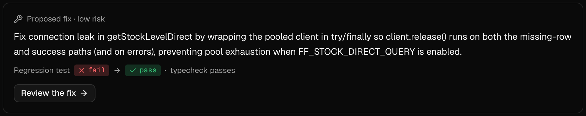
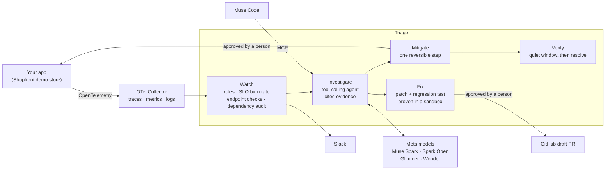

<p align="center">
  <picture>
    <source media="(prefers-color-scheme: dark)" srcset=".github/assets/triage-logo-dark-mode.svg">
    
  </picture>
</p>

<p align="center"><b>The AI SRE for teams with no SRE.</b><br>
It watches your service, finds the cause of an outage with cited evidence, stops the bleeding, and proves the fix, with a person approving every change.</p>

<p align="center">
  Meta Global AI Developer Hackathon · Indie Developer track · Build for Your World<br>
  <a href="https://youtu.be/gwnk319IIIo"><b>▶ Demo video (2:49)</b></a> ·
  <a href="#a-real-outage-start-to-finish">A real run</a> ·
  <a href="#how-it-uses-metas-models">Meta's models</a> ·
  <a href="#how-well-it-diagnoses">Benchmark</a> ·
  <a href="#quick-start">Quick start</a>
</p>

<p align="center">
  <a href="https://github.com/teapot2/triage/actions/workflows/ci.yml"></a>
  
  <a href="LICENSE"></a>
</p>


## Why Triage

Most small teams don't have a site reliability engineer. When production breaks, whoever wrote the code gets paged, if anyone does, and starts reading logs half asleep. Triage does that first hour of work: it notices the outage, investigates it like an SRE would, proposes the safest way out, and writes the fix, then hands every decision that changes something to a person.

## A real outage, start to finish

From the live run in the demo video (Nov 4, 2026), against the bundled demo store, with the agent on **Muse Spark Open served on Baseten**. The fault: a feature flag that switches stock lookups to a code path that leaks database connections.

| Time (UTC) | What happened |
| --- | --- |
| 23:15:05 | The flag goes on. Product requests start leaking connections, and the product API starts failing as the pool fills. |
| 23:15:50 | Watch's server-errors rule (over 5% errors on `GET /api/products`) opens an incident and posts to Slack. |
| 23:17:04 | **Root cause found in 74 s**, over 47 steps: the leak in `getStockLevelDirect` behind that flag, at 86% confidence, with two other causes ruled out. A mitigation is proposed: turn the flag off. |
| 23:17:35 | **Fix proven**: a regression test fails on the current code and passes with a `try … finally` patch, and the app typechecks. |
| 23:17:37 | A person approves the mitigation; Triage turns the flag off and hands back the 10 leaked connections. |
| 23:18:00 | The error rate is back to 0%. |
| 23:23:00 | Five quiet minutes under the limit: Triage resolves the incident. |
| 23:25:03 | A person approves the fix; Triage opens [draft PR #8](https://github.com/teapot2/triage/pull/8). |



## What it does

- **Watches** a service three ways: traffic rules and SLO burn-rate alerts on its telemetry, checks on public URLs from the outside, and a regular audit of its dependencies. Each outage opens one incident, with a toast and a Slack message.
- **Investigates** with a tool-calling agent over the service's logs, traces, metrics, database statistics, deploy history, git history and source. Every claim in the report cites the evidence behind it, and a report citing evidence that doesn't exist goes back to the model.
- **Mitigates first:** proposes one reversible step from what the diagnosis cites (turn a flag off, roll a release back), applies it once a person approves, and watches the metric recover.
- **Verifies** that the recovery holds for a quiet window before resolving the incident, and reopens it when it doesn't.
- **Proves a fix** in a sandbox: a regression test that fails on the current code and passes with the patch, plus a typecheck. Once a person approves it, Triage opens a draft pull request.
- **Answers follow-up questions** about the incident (typed, spoken or with a screenshot), **writes the blameless postmortem**, and serves all of it to coding agents over MCP.

## How it scores against the judging criteria

| Criterion | Evidence |
| --- | --- |
| **Impact** (30%) | Built for small teams with no on-call expertise, in the *Build for Your World* theme. In the run above, the outage went from fault to cause in about two minutes and was resolved with a person approving each change. It watches any public URL too, so a site with no telemetry still gets incidents. |
| **Use of Meta AI tooling** (25%) | Six Meta models and tools, each in its own role: [the table below](#how-it-uses-metas-models). Beyond chat: a tool-calling agent whose reports are schema-validated and must cite real evidence, parallel hypothesis checks led by Muse Wonder, 800k-token full-context answers, screenshots in questions, realtime voice biased toward the incident's own names, open weights on Baseten and Modal, and an MCP server for Muse Code. |
| **Demo** (25%) | [The demo video](https://youtu.be/gwnk319IIIo), plus a demo you can run: Shopfront's `/ops` page plants six faults: three flags, a bad release, a harmless release under load (the right answer is no rollback) and a vulnerable dependency. Recorded scenarios, a healthy control among them, run the live agent with only a Meta API key and no Docker. |
| **Technical depth and execution** (20%) | Cited evidence checked against what the tools returned; fixes proven in a throwaway copy of the app *and* its database; SLO multiwindow burn-rate alerts from the SRE Workbook; verification that reopens a relapse; a blind check that nothing Triage reads gives the planted bugs away; a graded benchmark; over 1,100 tests in CI. |

## How it works



1. **Watch** reads the service's telemetry every 10 seconds and opens one incident per outage.
2. **Investigate** runs an agent with read-only tools over telemetry, the database, deploys, git and source. It must submit a report whose every claim cites evidence it actually retrieved.
3. **Mitigate** proposes one fast, reversible step chosen by rule from the cited evidence, without another model call. Nothing is applied until a person approves it.
4. **Fix** writes a patch and a regression test, and proves both in a throwaway copy of the app and its database.
5. **Verify** keeps reading the alert's metric after the recovery, resolves the incident after a quiet window, and reopens it if the problem comes back.

### How it uses Meta's models

| Meta model or tool | What Triage uses it for |
| --- | --- |
| **Muse Spark** (Meta Model API) | The default for every stage: the investigating agent, the fix, follow-up questions (screenshots included) and the postmortem |
| **Muse Spark Open** (Baseten, OpenRouter or your own server) | Any stage; the run above investigated and fixed on it |
| **Muse Glimmer** (your own Modal deployment, OpenRouter, Fireworks or local) | Any stage; the "Glimmer" presets run all of them on open weights |
| **Muse Wonder** | Leads parallel hypothesis checks, and answers *Full context* questions with everything Triage holds on the service (up to 800k tokens) |
| **Muse Voice Transcribe** | Spoken questions, streamed in real time and biased toward the incident's service, route and host names |
| **Muse Code** | Reads Triage's incidents, evidence and proven patches from the terminal over MCP |

Each stage picks its own provider and model in **Settings → Models**; see [Models and providers](#models-and-providers).

## How well it diagnoses

Each recorded scenario replays a real run's telemetry with one planted cause; the grader checks the report against ground truth the agent never sees. Latest runs on Muse Spark, single agent:

| Scenario | What's planted | Root cause found |
| --- | --- | --- |
| `pool-leak` | A connection leak behind a feature flag | 9 / 10 |
| `price-gap` | Missing price rows behind a feature flag | 8 / 10 |
| `live-ratings` | An N+1 query loop behind a feature flag | 10 / 10 |
| `bad-deploy` | A release that breaks an API route; the right step is a rollback | 20 / 20 |
| `traffic-rush` | A harmless release, then a traffic rush; the right answer is the load, with no rollback | 20 / 20 |
| `vulnerable-dependency` | A vulnerable package; is it reachable from the code? | 20 / 20 |
| `healthy` | Nothing (control) | no false positives |

`pnpm --filter @triage/web benchmark` reruns them; see "Benchmark" in [`apps/triage/README.md`](apps/triage/README.md).

## Quick start

You need Node 24 or later, pnpm 12 (`npm install -g pnpm@12`), Docker (Postgres and the OpenTelemetry Collector run in it) and a [Meta Model API](https://dev.meta.ai/products/meta-model-api) key. Git and the GitHub CLI (`gh`) are used when an approved fix opens a pull request.

```bash
git clone https://github.com/teapot2/triage.git
cd triage
cp apps/triage/.env.example apps/triage/.env.local   # fill MODEL_API_KEY here
cp apps/shopfront/.env.example apps/shopfront/.env
pnpm install
pnpm infra:up                                    # Postgres on 5433, collector on 4317/4318
pnpm --filter @triage/shopfront db:migrate
pnpm --filter @triage/shopfront db:seed          # about 15 s; safe to run again
pnpm dev
```

Triage runs on http://localhost:3000, Shopfront on http://localhost:3001. `pnpm infra:down` stops the containers. Each app owns its env file; commit only `.env.example` templates.

### Try it

1. **No Docker, one key:** open Triage at http://localhost:3000 and press **Run investigation**, then pick a recorded scenario. The agent investigates the replayed telemetry live; only `MODEL_API_KEY` is needed. Recorded runs stop at the diagnosis and the mitigation, since there's no code to patch. The bundled example incidents open without any key.
2. **A live outage:** open Shopfront's demo controls at http://localhost:3001/ops and press **Start traffic**, then turn on **Connection pool leak**. The pool fills in about two minutes, the watch opens an incident, and Triage investigates it live: open it from the toast or the list.
3. **On the incident:** the report cites its evidence; approve the proposed mitigation (the flag off) and watch the metric recover and the verification resolve it; the fix stage proves a patch in a sandbox before it asks for approval. Ask follow-up questions and write a postmortem from the same page.
4. **Other faults:** turn the fault off on `/ops` before trying the next one; only one runs at a time. **Price list gap** and **Live ratings loop** are flags like the first. The releases deploy a commit, so cut its branch once first: `pnpm --filter @triage/shopfront release formatted-price` (or `journal-copy`, `vulnerable-dep`).
   - **Formatted price** breaks the product API on deploy; expect a rollback.
   - **Journal copy** changes nothing that matters: deploy it, then pick a faster traffic preset on the Traffic card. Triage should blame the load, not the release.
   - **Vulnerable dependency** changes nothing on the dashboards: deploy it, then press **Audit now** in the Dependencies section of Triage's Watch page.

Approving a fix pushes a branch to `origin` and opens a draft pull request with `gh`, so that step needs a clone you can push to (a fork) and `gh auth login`. Without them, the incident shows why the PR failed, with a Retry, and the proven patch stays on the page.

## Features in depth

### Endpoint checks

- Checks any public URL from the outside, so a site with no SDK or telemetry still gets incidents.
- Opens one incident after three slow responses in a row, or five minutes with no acceptable response, and resolves it on confirmed recovery. Slack hears at both ends.
- A check on Shopfront also investigates with Shopfront's telemetry, so the whole pipeline runs from an outside probe. Elsewhere, the report says what the results show and names what's missing.
- Private and loopback targets are refused (`TRIAGE_UPTIME_ALLOW_PRIVATE=1` allows them in development).

### Mitigate first

- One step, chosen by rule from the evidence the diagnosis cites: turn off the cited feature flag, or roll back the cited deploy.
- Applied only after a person approves, through Shopfront's ops API (`OPS_ENABLED=1` in a production build, `SHOPFRONT_URL` if the store runs elsewhere). A rollback reverse-applies the deployed release's diff.
- For a leaked connection pool, the flag-off also recycles the held connections, since turning the flag off frees none of them.
- Triage then re-reads the alert's metric until it recovers. The proven patch still follows as the permanent fix.

### Verify

- After the recovery, waits for 5 quiet minutes under the threshold (`TRIAGE_RESOLVE_AFTER_MINUTES` to change it), then resolves the incident on its own.
- If the metric climbs back during the window, the incident reopens and says so. A new breach on the same rule within 30 minutes of resolving reopens it too, instead of opening a duplicate.
- A pending fix approval doesn't hold up the resolution; the incident stays under Needs attention until someone decides it.
- Resolve, reopen or verify again by hand from the header's menu or the command palette.

### Ask Triage

- Follow-up questions on the incident page, answered token by token, citing evidence with clickable chips.
- Paste a screenshot (a dashboard panel, an error page) with the question.
- **Full context** answers in one call to Muse Wonder (Muse Spark Open on an open-weights setup) with everything Triage holds on the service, up to 800k tokens: source, git history, deploys, earlier incidents and telemetry.
- **Web search** looks up a library's public docs and cites them. The model picker changes the model for one question.
- **Voice** (Settings → General → Speech): the mic streams to Meta's **Muse Voice Transcribe** (`muse-voice-transcribe-1.0`, about $0.18 per hour of audio) through Triage's server, so the key never reaches the browser. It's biased toward the incident's service, route and host names, so "shopfront" doesn't come out "shop front". Answers can be read aloud.
- Deny a fix with feedback, and Triage writes a new attempt.

### Postmortem

- Written on request from the incident's record. Every claim cites its evidence, and blaming language is sent back to the model.
- Default sections: summary, impact, timeline, how the diagnosis held up, contributing factors, what went well, where we got lucky, action items.
- Copy as Markdown, download as Markdown or PDF, and export the action items as CSV for a tracker.
- The sections are a template the team edits in **Settings → Postmortems**. The model is the **Postmortem** stage in Settings → Models.

### Use Triage from Muse Code

- Triage is also an MCP server, so Meta's Muse Code (or any MCP client) can ask it about incidents from the terminal.
- It returns the cited report, the evidence in full, the proven patch or the postmortem, and can save a follow-up question on the incident.
- Read-only apart from saving a question; approvals stay on the incident page. Tools and access are in [`apps/triage/README.md`](apps/triage/README.md).

Add it to `~/.config/muse/settings.json`:

```json
{
  "schema_version": 1,
  "mcpServers": {
    "triage": { "transport": "streamable_http", "url": "http://localhost:3000/api/mcp", "mode": "optional" }
  }
}
```

## Models and providers

Each stage that calls a model (**Investigate**, **Fix**, **Ask** and **Postmortem**, plus **Lead** when hypotheses are checked in parallel) has its own provider and model, chosen in Triage's **Settings → Models**. Every provider is an OpenAI-compatible endpoint:

| Provider | Endpoint | Key |
| --- | --- | --- |
| Meta Model API | `https://api.meta.ai/v1` (or `MODEL_API_BASE_URL`) | `MODEL_API_KEY` |
| OpenRouter (Muse Glimmer, Muse Spark Open, Spark, Wonder) | `https://openrouter.ai/api/v1` | `OPENROUTER_API_KEY` |
| Fireworks | `https://api.fireworks.ai/inference/v1` | `FIREWORKS_API_KEY` |
| Baseten (Muse Spark Open) | `https://inference.baseten.co/v1` (or `BASETEN_API_BASE_URL`) | `BASETEN_API_KEY` |
| Modal (your own Muse Glimmer deployment, [`infra/modal/glimmer.py`](infra/modal/glimmer.py)) | `MODAL_BASE_URL` | `MODAL_API_KEY` |
| LM Studio | `http://localhost:1234/v1` (editable in Settings) | optional |
| Ollama | `http://localhost:11434/v1` (editable) | optional |
| llama.cpp server | `http://localhost:8080/v1` (editable) | optional |
| Custom endpoint (vLLM, any OpenAI-compatible server) | any base URL, set in Settings | optional, saved in Settings |

Put hosted keys in `apps/triage/.env.local` and restart. Keys entered in Settings are saved server-side in `apps/triage/.data/triage.db` (gitignored) and never sent to the browser.

**Open-weights mode.** The "Glimmer" presets run every stage on Muse Glimmer (Meta's open-weights 30B model) on OpenRouter, Fireworks or a local server; Settings shows an "Open weights" badge when every stage runs on open weights. Until it is changed, every stage runs `MODEL_ID` (Muse Spark) on Meta's API, except Lead, which starts on Muse Wonder.

**Built with Muse Spark Open.** Any stage can run on Muse Spark Open, the open weights of Meta's Muse Spark, through OpenRouter, Baseten or your own server; the "Spark Open" presets set every stage at once. Muse Spark Open is licensed under the [Muse Model License](https://huggingface.co/meta-models/Muse-Spark-Open-816B-A42B), and Settings → Models shows "Built with Muse Spark Open" whenever a stage runs it.

Check a stage from Settings, or call `GET /api/ping-model?stage=investigate` (may incur charges). `GET /api/health` shows each stage's model without calling it.

## Testing and evaluation

```bash
pnpm lint
pnpm typecheck
pnpm test                                   # no model calls
pnpm --filter @triage/web check:blind       # nothing Triage can read gives the planted bugs away
pnpm --filter @triage/web check:sandbox     # proves known-good fixes in the sandbox; the real database stays unchanged
pnpm --filter @triage/web benchmark         # the diagnosis benchmark above (calls models, costs a little)
```

[CI](.github/workflows/ci.yml) runs lint, typecheck, the tests and the blind check on every push to `main` and every pull request.

## Limitations and safety

- **A person approves every change.** Triage applies a mitigation, opens a pull request or changes a flag only after someone approves it on the incident page. Pull requests are drafts, and nothing merges on its own. The MCP tools only read, apart from saving a question.
- **The model can be wrong.** Every claim in a report must cite evidence the tools returned, and a report citing evidence that doesn't exist is sent back; the report says what it ruled out and why. Still, treat it as a strong first opinion, not a verdict.
- **Where it's wired up today.** Live investigation reads the telemetry the bundled OpenTelemetry Collector writes, through a `TelemetrySource` interface another store can implement. Mitigations are applied through Shopfront's ops API, the one executor so far. Endpoint checks and dependency audits work beyond it.
- **Run it on a trusted machine.** The web app has no user accounts. Keys stay on the server and never reach the browser; without `TRIAGE_MCP_TOKEN`, the MCP server answers only on loopback; endpoint checks refuse private addresses unless allowed.

## Repository layout

- [`apps/triage`](apps/triage) — the Triage web app and agent (Next.js, Vercel AI SDK, Meta Model API). Its [README](apps/triage/README.md) is the full reference: endpoints, watch rules, SLOs, the agent, the fix sandbox, MCP tools, exports.
- [`apps/shopfront`](apps/shopfront) — the instrumented demo store (Next.js, Postgres, OpenTelemetry) with planted faults and demo controls; see its [README](apps/shopfront/README.md).
- [`infra`](infra) — Postgres and the OpenTelemetry Collector (Docker Compose), and the Modal deployment for Muse Glimmer.

## Built during the hackathon

Built solo by **Sebastián Segovia** during the Meta Global AI Developer Hackathon's build window, **Oct 26 to Nov 4, 2026**. The only earlier work is boilerplate for the Shopfront demo store, started around Oct 24–25.

## Acknowledgments

- Meta's models: Muse Spark, Muse Spark Open, Muse Glimmer, Muse Wonder, Muse Voice Transcribe and Muse Code.
- Baseten and Modal, for serving the open weights.
- The *Site Reliability Workbook*'s "Alerting on SLOs", which Triage's burn-rate alerts follow.
- OpenTelemetry, Next.js, the Vercel AI SDK and shadcn/ui.

## License

Triage is released under the [MIT License](LICENSE). Muse Spark Open, when a stage runs it, is under its own [Muse Model License](https://huggingface.co/meta-models/Muse-Spark-Open-816B-A42B).
